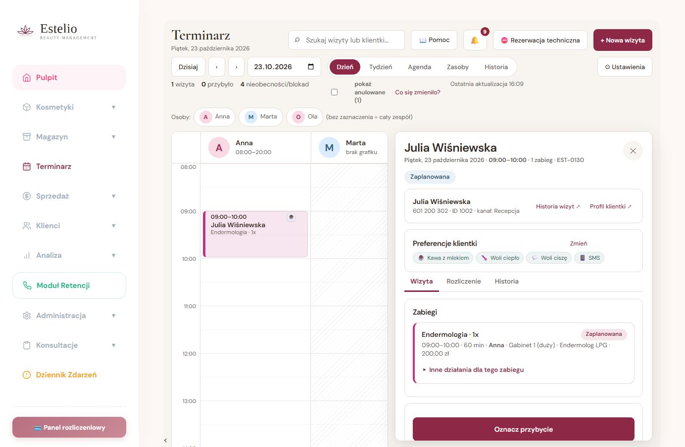
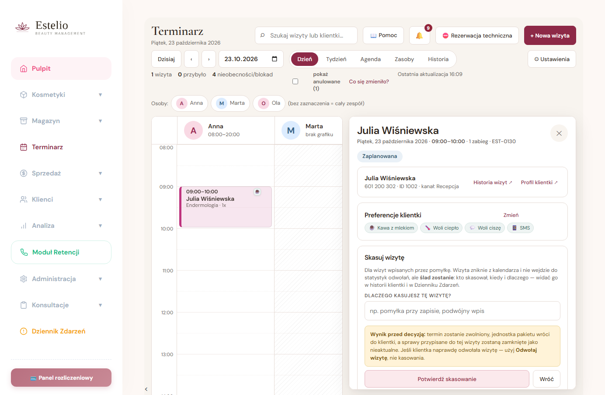
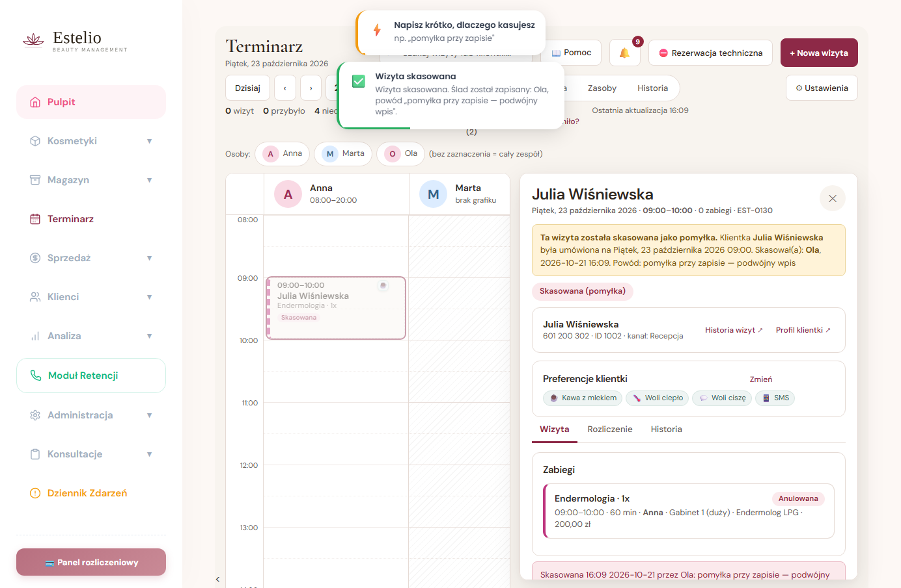
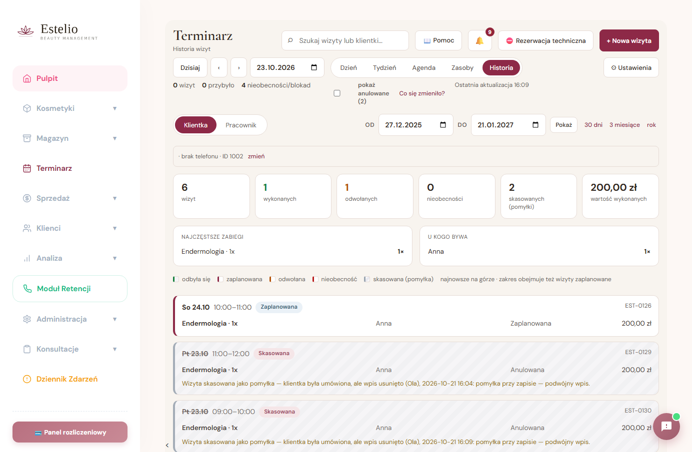

# Skasowanie wizyty wpisanej przez pomyłkę

Zgłoszenie właściciela, 21.10.2026:
> „nie ma opcji »skasuj« przy szczegółach wizyty, to na wypadek gdyby ktoś zwyczajnie się pomylił
> albo chciał tylko skasować. Niech będzie informacja że takie kasowanie miało miejsce,
> że klient był umówiony ale wizyta została skasowana."

## Dlaczego to NIE jest odwołanie

To dwie różne rzeczy i celowo nie zlewamy ich w jedno:

| | Odwołanie | Skasowanie |
|---|---|---|
| Co opisuje | zdarzenie z życia salonu — klientka albo salon odwołali wizytę | „tej wizyty w ogóle nie powinno tu być" |
| Statystyki | liczy się do **odwołań** | ma **własny licznik** („skasowanych (pomyłki)"), nie zaśmieca odwołań |
| Sprawa do obsługi | zakłada sprawę (E05 — odwołanie do obsłużenia) | nie zakłada; domyka wiszące sprawy jako nieaktualne |
| Ślad | powód odwołania | kto, kiedy i dlaczego skasował — widoczny w historii klientki i w Dzienniku Zdarzeń |

Klientka naprawdę była umówiona, więc wpis **nie znika z bazy** — zostaje oznaczony
(`usunieta = 1`) i opisany. Z kalendarza znika, bo w kalendarzu go być nie powinno.

## Czego skasować nie można

Blokady są po stronie serwera (`trm_usun` w `routes/terminarz.js`), nie tylko w UI:

- wizyty **rozliczonej w Sprzedaży** — pomyłkę naprawia się korektą sprzedaży, bo w grę wchodzą pieniądze,
- wizyty **wykonanej, w trakcie albo przerwanej** — od tego jest korekta wykonania,
- **bez powodu** (krócej niż 3 znaki) — ślad ma coś znaczyć,
- przy **nieaktualnej wersji** wizyty (ktoś w międzyczasie ją zmienił) — `code: WERSJA`,
- przez osobę **bez uprawnień operacyjnych** (np. kosmetolog bez roli recepcji/managera).

Powtórne skasowanie tej samej wizyty nie robi nic drugi raz (`powtorzenie: true`).

## Co się dzieje przy skasowaniu

Wszystko pod blokadą salonu, w jednej transakcji — tej samej, co przy zapisie wizyty:

1. pozycje → `anulowana`, `Term_Zajecia` → `aktywne = 0` (**termin wraca do puli**),
2. jednostki pakietu wracają do klientki (ZK-02 `zwolnij`),
3. `Term_Rezerwacje`: `status='anulowana'`, `usunieta=1`, `usunieta_kiedy=NOW()`, `usunieta_przez`, `usunieta_powod`,
4. wpis w `Term_Historia` z akcją **`usunieto`** i powodem,
5. wpis w **Dzienniku Zdarzeń** („TERMINARZ: SKASOWANIE WIZYTY") — żeby ślad przetrwał, nawet gdy nikt nie zajrzy do historii wizyty,
6. sprawy przypisane do tej wizyty (E13, E05) domknięte jako **nieaktualne**; nowa sprawa odwołania **nie powstaje**.

Nowe kolumny dokładane idempotentnie przy starcie (`alterKolumna`), bez migracji ręcznej:
`usunieta`, `usunieta_kiedy`, `usunieta_przez`, `usunieta_powod`.

## Jak to wygląda u recepcji

**1. Przycisk** — szczegóły wizyty → „Więcej działań", na końcu, obok „Odwołaj wizytę".
Pokazuje się tylko wtedy, gdy wizytę wolno skasować.



**2. Formularz** — mówi wprost, co się stanie, i odsyła do odwołania, jeśli klientka
naprawdę odwołała wizytę.



**3. Po skasowaniu** — żółta ramka w panelu („klientka była umówiona na…, skasował(a) …, powód …"),
plakietka **Skasowana (pomyłka)**, kafelek na siatce dnia podpisany **Skasowana**
(widoczny tylko przy „pokaż anulowane").



**4. Ślad w historii klientki** — osobny kolor w legendzie, tło w ukośne paski,
osobny kafelek „skasowanych (pomyłki)" obok „odwołanych", pełne zdanie pod wpisem.



## Próba w izolowanym środowisku (21.10.2026, 16:09)

Lokalna MariaDB 11.8.9 na porcie 3307, salon `demo-test`, serwer 3999, Chrome headless.
Skrypt: `proba.js` w tym katalogu.

```
umowiono wizyte do skasowania: 130 (Julia Wiśniewska, 23.10 09:00)
przyciski w „Więcej działań": Oznacz jako wykonany (bez „Rozpocznij") | Nie wykonano |
  Odmowa kwalifikacji | Przełóż całą wizytę | Spóźniona | Nieobecna (potwierdzona) |
  Odwołaj wizytę | Skasuj wizytę
ostrzezenie: Wynik przed decyzją: termin zostanie zwolniony, jednostka pakietu wróci do
  klientki, a sprawy przypisane do tej wizyty zostaną zamknięte jako nieaktualne…
po próbie bez powodu — czy wizyta nadal aktywna: true
po skasowaniu — stan wizyty: {"usunieta":true,"przez":"Ola","powod":"pomyłka przy zapisie — podwójny wpis"}
komunikat w panelu: Ta wizyta została skasowana jako pomyłka. Klientka Julia Wiśniewska była
  umówiona na Piątek, 23 października 2026 09:00. Skasował(a): Ola, 2026-10-21 16:09.
  Powód: pomyłka przy zapisie — podwójny wpis
czy jest na siatce dnia: false
historia klientki:
    Pt 23.10   Skasowana   Wizyta skasowana jako pomyłka — klientka była umówiona, ale wpis usunięto (Ola)…
kafelki: 6 wizyt | 1 wykonanych | 1 odwołanych | 0 nieobecności | 2 skasowanych (pomyłki) | 200,00 zł
BLEDY JS: brak
```

## Testy automatyczne

`tests/terminarz-usuwanie.test.js` — 12 prób na atrapie bazy (supertest + express):
7 × czego nie wolno skasować, 5 × jaki ślad ma zostać. Pełny zestaw po zmianie:
**37 zestawów, 751 prób — wszystkie przechodzą.**
